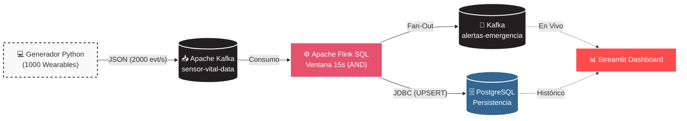

# Sistema de Alertas de Salud en Tiempo Real

**Detección de emergencias cardiopulmonares en streaming para wearables (Bucaramanga)**

[](https://www.docker.com/)
[](https://kafka.apache.org/)
[](https://flink.apache.org/)
[](https://www.postgresql.org/)
[](https://streamlit.io/)

*Proyecto Final - Big Data*

---

## 📖 Descripción General

Este proyecto implementa una arquitectura **End-to-End de Streaming** diseñada para procesar datos biométricos masivos generados por dispositivos wearables. El sistema ingiere telemetría, detecta anomalías médicas (crisis de taquicardia e hipoxemia) en ventanas de tiempo de 15 segundos, y emite alertas inmediatas.

Además, **garantiza la persistencia histórica** de las alertas en una base de datos relacional, permitiendo auditorías y análisis posteriores, todo visualizado a través de un dashboard interactivo en tiempo real.

## 🏗️ Arquitectura del Sistema

El sistema sigue un patrón de **Event-Driven Architecture (EDA)** contenerizado al 100% con Docker.



## Características Principales

- **Ingesta Masiva:** Simulación de 1000 pacientes enviando datos cada 0.5 segundos (~2000 eventos/seg).
- **Procesamiento en Ventanas:** Uso de *Tumbling Windows* de 15s en Flink SQL.
- **Lógica Compuesta:** Regla médica `MAX(HR) > 130 AND MIN(SpO2) < 90` para evitar falsos positivos (ej. ejercicio físico).
- **Persistencia Idempotente:** Uso de `UPSERT` en PostgreSQL para evitar alertas duplicadas ante reinicios del sistema.
- **Dashboard Dual:** Pestaña "En vivo" (baja latencia vía Kafka) y pestaña "Historial" (consultas SQL vía Postgres).

## 🛠️ Stack Tecnológico

| Tecnología       | Rol en la Arquitectura                                       |
| :--------------- | :----------------------------------------------------------- |
| **Python**       | Simulación de sensores (`generator.py`) y lógica del dashboard. |
| **Apache Kafka** | Bus de mensajes distribuido (Modo KRaft, sin Zookeeper).     |
| **Apache Flink** | Motor de procesamiento de flujos (Flink SQL 1.18).           |
| **PostgreSQL**   | Almacenamiento relacional histórico (Persistencia).          |
| **Streamlit**    | Interfaz de usuario y visualización de datos en tiempo real. |
| **Docker**       | Orquestación y despliegue de todos los servicios.            |

## 🚀 Guía de Inicio Rápido

### Requisitos Previos
- Tener instalado **Docker** y **Docker Compose v2**.
- Puertos libres: `9092` (Kafka), `8081` (Flink UI), `8501` (Dashboard), `5432` (PostgreSQL).

### Ejecución en Linux / macOS
```bash
# 1. Clonar el repositorio
git clone https://github.com/tu-usuario/tu-repositorio.git
cd tu-repositorio

# 2. Dar permisos de ejecución a los scripts
chmod +x start.sh stop.sh

# 3. Levantar el sistema (descarga imágenes y JARs automáticamente)
./start.sh
```

### Ejecución en Windows
```powershell
# 1. Clonar el repositorio
git clone https://github.com/tu-usuario/tu-repositorio.git
cd tu-repositorio

# 2. Ejecutar el script de PowerShell
powershell -ExecutionPolicy Bypass -File .\start.ps1
```

> **Nota:** La primera ejecución tomará unos 4-6 minutos descargando las imágenes de Docker y las dependencias de Flink. Las siguientes ejecuciones tomarán menos de 1 minuto.

## 🌐 Puntos de Acceso

Una vez el sistema esté corriendo, puedes acceder a:

- **Dashboard de Alertas:** [http://localhost:8501](http://localhost:8501)
- **Interfaz Web de Flink:** [http://localhost:8081](http://localhost:8081)
- **Base de Datos PostgreSQL:** `localhost:5432` (User: `health` | Pass: `health` | DB: `health`)

## 📂 Estructura del Proyecto

```text
📦 ProjectBigData
 ┣ 📜 docker-compose.yml      # Orquestación de servicios
 ┣ 📜 Dockerfile              # Imagen base de Python para el generador y dashboard
 ┣ 📜 generator.py            # Simulador de datos de wearables
 ┣ 📜 job.sql                 # Job de Flink SQL (ventanas y reglas médicas)
 ┣ 📜 dashboard.py            # Interfaz Streamlit (Vivo e Historial)
 ┣ 📜 init.sql                # Esquema de base de datos inicial (PostgreSQL)
 ┣ 📜 requirements.txt        # Dependencias de Python
 ┣ 📂 flink-libs              # JARs de conectores (Kafka, JDBC, PostgreSQL)
 ┣ 📜 start.sh / start.ps1    # Scripts de arranque automatizado
 ┗ 📜 stop.sh / stop.ps1      # Scripts de detención y limpieza
```

## 🧠 Decisiones de Diseño Clave

1. **¿Por qué Flink y no Python Puro?** Flink maneja estado, ventanas de tiempo y tolerancia a fallos de forma nativa, lo cual es vital para el procesamiento de flujos continuos sin pérdida de datos.
2. **Fan-Out en Flink:** Usamos `EXECUTE STATEMENT SET` para leer el tópico de sensores una sola vez y escribir simultáneamente en Kafka y PostgreSQL, optimizando los recursos del clúster.
3. **Idempotencia:** Si el sistema falla y se reinicia, la cláusula `PRIMARY KEY (alert_id) NOT ENFORCED` en Flink y PostgreSQL asegura que las alertas no se dupliquen (UPSERT).
4. **Persistencia (PostgreSQL):** Se eligió Postgres sobre Object Storage (ej. MinIO) porque las alertas médicas son datos estructurados que requieren consultas relacionales rápidas (agregaciones, filtros) para el análisis histórico.

## 👥 Autores

- **Santiago Sepúlveda Blanco** - 2243557
- **Sebastian Baldovino** - 2243565

*Universidad Industrial de Santander - Big Data*
